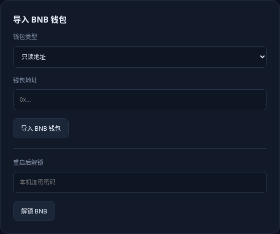
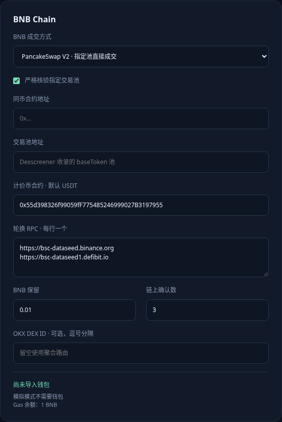
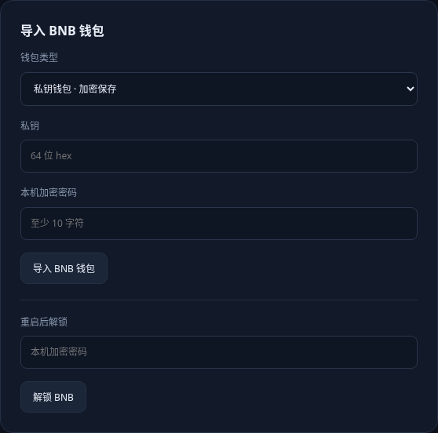

# BNB 钱包：只读导入、私钥导入与解锁

以下图片是 ChainDesk 实际页面截图，未填写任何私钥。初次先使用只读地址，核对后再导入签名私钥。

## 一、找到 BNB Chain 钱包地址

使用 MetaMask、OKX Web3、Trust Wallet 等支持 BNB Smart Chain 的自托管钱包。若已有钱包，选择 BNB Smart Chain / BNB Chain 网络，再进入接收页面复制账户地址。

MetaMask 可从 https://metamask.io/download/ 的官方链接安装。创建钱包并离线备份助记词后，在网络选择中启用 BNB Smart Chain；若需手工添加，网络参数为：

| 项目 | 内容 |
|---|---|
| 网络名称 | BNB Smart Chain |
| RPC | https://bsc-dataseed.binance.org |
| Chain ID | 56 |
| 货币符号 | BNB |
| 浏览器 | https://bscscan.com |

BNB 账户地址以 0x 开头，后面 40 个十六进制字符。Ethereum 与 BNB 的同一 EVM 账户可能使用相同地址，但链上余额独立，Ethereum 主网余额不会显示为 BNB 余额。

不要使用交易所充值地址导入签名钱包，因为你通常没有它的私钥。工具需要你自己控制的钱包账户。Solana 地址、代币合约地址与 BNB 接收地址不能混用。

## 二、只读导入



1. 浏览器打开终端显示的本机网址，保持启动终端开启。
2. 左侧点击“设置与钱包”，先保持“模拟 · 不广播交易”，关闭自动套利与自动再平衡。
3. 向下找到“导入 BNB 钱包”。
4. 钱包类型选择“只读地址”。
5. 钱包地址填自己在 BNB Smart Chain 上的 0x 接收地址。
6. 点击“导入 BNB 钱包”，等待“钱包已导入”提示。
7. 回到上方 BNB 配置卡底部，核对“只读钱包”和账户地址首尾字符。

只读导入不填私钥、密码，也不需要解锁。钱包导入按钮是单独提交，不必依靠“保存设置”。模拟模式显示模拟余额，不是个人钱包实际余额。

## 三、钱包与币对字段分别填写



| 字段 | 应填内容 |
|---|---|
| 导入 BNB 钱包 → 钱包地址 | 个人账户接收地址 |
| BNB Chain → 同币合约地址 | 套利代币在 BNB Chain 上的合约 |
| BNB Chain → 交易池地址 | 与配置 USDT 直接配对的 PancakeSwap V2 池 |
| BNB Chain → 计价币合约 | 初次保持默认 USDT |

这几类地址都可能以 0x 开头，但用途不同，不能互相复制替代。

首次 BNB 链配置：成交方式保持“PancakeSwap V2 · 指定池直接成交”；严格核验保持勾选；Gas 保留 0.01 BNB；链上确认数 3；DEX ID 留空。轮换 RPC 每行一个，默认可用：

```text
https://bsc-dataseed.binance.org
https://bsc-dataseed1.defibit.io
```

默认计价币 USDT 合约：

```text
0x55d398326f99059fF775485246999027B3197955
```

同币与池地址需要根据你要套利的资产核对；不能仅靠名称证明两链同币。BNB 默认路由不支持把 V3 池作为 V2 池填写。修改完点击“保存设置”，保存会关闭自动执行。

## 四、查看真实余额

两链币对、池和只读钱包配置齐全后，运行模式切为“实盘 · 主网交易”，保存，保持自动执行关闭。回到首页等待轮询，核对 BNB RPC、稳定币、套利币库存和 Gas 余额与钱包应用一致。“BNB 钱包未解锁或为只读钱包”是这个阶段的正常执行阻止原因。币对资料未齐时先完成只读导入，不要切换实盘。

两侧需分别准备原生币、计价币和套利币库存。BNB 侧的 0.01 BNB 是执行后仍须保留的资金，所以余额需要高于保留值，并额外覆盖授权和交易费用。USDT 或 WBNB 不能直接替代原生 BNB 付 Gas。高价链库存不足会阻止买入。

首次转入时，网络选 BNB Smart Chain / BEP20，核对资产合约并先小额验证到账；不要误选 Ethereum、Solana 或旧 BNB Beacon Chain / BEP2。交易所提现费和最低提现额另外计算。

## 五、准备实盘时导入私钥



本工具没有钱包扩展弹窗授权签名功能。要由工具执行，需要导入私钥；只读地址不能执行。

1. 在自托管钱包中选择目标账户，找到账户详情中的“显示私钥 / 导出私钥”，按钱包要求输入其登录密码。不同钱包版本菜单不同；硬件钱包通常无法导出私钥。
2. 确认工具网址以 `http://127.0.0.1:` 开头。
3. 在“导入 BNB 钱包”中选择“私钥钱包 · 加密保存”。
4. 私钥填写 64 个十六进制字符，可有 0x 前缀。不是 0x 接收地址、助记词，也不是加密 JSON 文件。
5. 设置至少 10 字符的“本机加密密码”，建议 BNB 与 Solana 分别设置。
6. 点击“导入 BNB 钱包”，工具会从私钥推导地址并替换该链此前的只读钱包记录。
7. 核对页面显示地址与钱包应用的目标账户一致，状态应为“签名钱包 · 已解锁”。不一致时先停止操作，不要转入资金。

密码不会保存，忘记密码后不能直接解锁旧密文，需要你另外保管的原始私钥或钱包备份。私钥、助记词、密码与 API Secret 不要发送到聊天里或上传网盘。程序可使用导入私钥签名，无需额外钱包弹窗授权，建议使用专用小额账户。

## 六、重启后解锁

1. 重新启动工具并打开本机页面。
2. 打开“设置与钱包”。BNB 钱包加密记录保留，默认已锁定。
3. 在“导入 BNB 钱包 → 重启后解锁”输入此前设置的本机加密密码。
4. 点击“解锁 BNB”，核对状态“签名钱包 · 已解锁”。

不是填写私钥、助记词或 MetaMask 登录密码。只读钱包无需解锁。“锁定全部凭据”会锁定两链钱包与 OKX 凭据；解锁与重启不会自动启用交易。

## 七、第一次执行前

本工具实盘和跨链尚未用真实账户验证。先核对真实行情及余额、两侧库存、Solana 与 BNB 签名钱包、OKX 开发者凭据与所有执行阻止原因。保持自动执行关闭，首次手动试单限制金额 1U、次数 1、累计金额 1U。出现单边失败时按档案哈希核对链上状态，不要反复重试。
