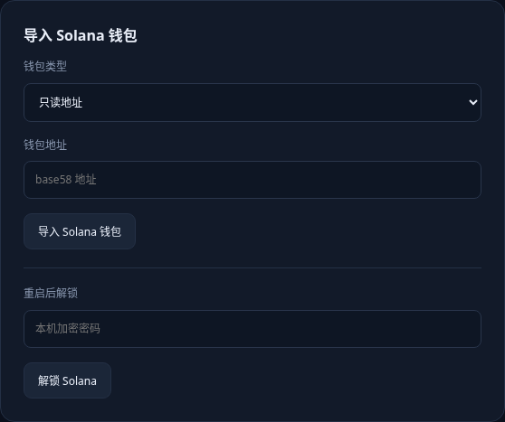
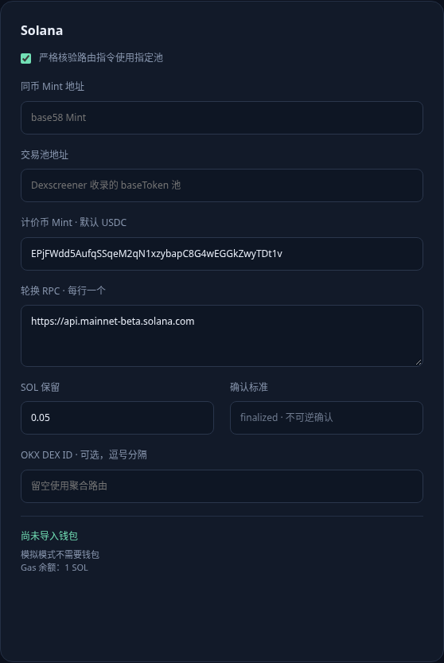
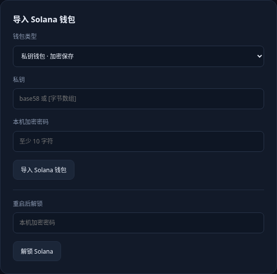

# ChainDesk：设置与钱包首次配置

以下截图来自工具实际页面，没有输入任何私钥或凭据。先完成只读导入，再核对币对；拥有 Solana 钱包并不代表已具备两链套利所需资金与库存。

## 1. 打开页面并关闭自动执行

保持启动终端开启，浏览器打开终端显示的 `http://127.0.0.1:端口`。在“行情首页”关闭“利润达标自动执行”，在“OKX 跨链”关闭“自动再平衡”。首次填写时，“设置与钱包 → 运行模式”保持“模拟 · 不广播交易”。保存设置会关闭自动执行。

## 2. 先导入 Solana 只读地址



1. 在钱包应用中选择 Solana 网络，点击“接收 / Receive”，复制个人钱包地址。
2. 在工具左侧选择“设置与钱包”，向下滚动到“导入 Solana 钱包”。
3. “钱包类型”选择“只读地址”。
4. 在“钱包地址”中粘贴刚复制的接收地址，点击“导入 Solana 钱包”。这是独立的提交按钮，不是上方“保存设置”。
5. 页面提示“钱包已导入”后，查看 Solana 配置卡底部的“只读钱包”和地址，核对首尾字符。
6. 只读导入不填私钥、不填加密密码，也不需要点击“解锁 Solana”。

模拟模式展示的是模拟行情和模拟余额，即使导入了真实地址也不会变成真实余额。

## 3. 分清三类地址

| 地址 | 用途 | 填在哪里 |
|---|---|---|
| 钱包接收地址 | 接收你自己的资金 | 导入 Solana 钱包 → 钱包地址 |
| 代币 Mint 地址 | 标识要套利的代币 | Solana → 同币 Mint 地址 |
| 池地址 | 标识具体交易市场 | Solana → 交易池地址 |

三个字段不能填写同一个地址。Solana Mint 和池地址也常为 base58 格式，单看外观不能区分。

## 4. 填写运行模式和两链币对

“运行模式与资产”暂时选择模拟；代币名称是显示名称，不能证明两链代币相同。轮询间隔保持 8 秒。只有核对项目官方资料、确认两链资产相同且已准备两侧资金和库存后，才勾选“我已核对两链合约代表同一资产，并准备了独立资金和库存”。



Solana 配置：

| 字段 | 怎么填 |
|---|---|
| 严格核验路由指令使用指定池 | 保持勾选 |
| 同币 Mint 地址 | 待套利代币在 Solana 上的 Mint，需与官方资料核对 |
| 交易池地址 | 该代币的具体池地址；Dexscreener 必须收录，且该代币为 baseToken |
| 计价币 Mint | 默认 USDC，首次保持默认 |
| 轮换 RPC | 每行一个 Solana 主网 RPC；可先用默认一个 |
| SOL 保留 | 默认 0.05 SOL，这是执行后仍需保留的资金 |
| 确认标准 | 固定 finalized，不需要修改 |
| OKX DEX ID | 暂时留空；这是 DEX 标识，不是池地址 |

默认 Solana USDC Mint：

```text
EPjFWdd5AufqSSqeM2qN1xzybapC8G4wEGGkZwyTDt1v
```

默认 RPC：

```text
https://api.mainnet-beta.solana.com
```

有可信的额外主网 RPC 时再按每行一个添加。公共 RPC 可能限流。RPC 与私钥没有关系，不要在 RPC 输入框填写钱包秘密。

BNB 配置：

| 字段 | 怎么填 |
|---|---|
| BNB 成交方式 | 首次保持 PancakeSwap V2 · 指定池直接成交 |
| 严格核验指定交易池 | 保持勾选 |
| 同币合约地址 | 同一套利资产的 BNB Chain 合约地址 |
| 交易池地址 | 该套利币与配置 USDT 的直接 PancakeSwap V2 池，不能填写 V3 池 |
| 计价币合约 | 保持默认 BNB Chain USDT |
| 轮换 RPC | 保留默认主网 RPC，每行一个 |
| BNB 保留 | 默认 0.01 BNB |
| 链上确认数 | 默认 3 |
| OKX DEX ID | 暂时留空 |

默认 BNB Chain USDT：

```text
0x55d398326f99059fF775485246999027B3197955
```

默认 BNB RPC：

```text
https://bsc-dataseed.binance.org
https://bsc-dataseed1.defibit.io
```

从项目官方资料核对两链合约，再在 Dexscreener 查找匹配的市场，查看链、代币、DEX、版本、计价币和完整池地址。不要只依据代币名称搜索后选择第一个结果。BNB 默认成交只支持与配置计价币直接配对的 PancakeSwap V2 池；Solana 严格路由必须实际使用指定池。查询得到价格并不代表能成交。

如果还没有代币和池资料，保持未填写、不要切换实盘。只有一个 Solana 钱包时，可先完成 Solana 只读导入；工具没有单链套利功能。BNB 钱包也需单独导入其 BNB Chain 的 0x 地址。

## 5. 设置一次小额执行的风控

下面是首次手动试单的限制示例，不保证产生套利机会或盈利。填入后点击“保存设置”；第一次仍保持模拟模式。

| 字段 | 示例值 | 含义 |
|---|---|---|
| 单次金额 / U | 1 | 每次低价链买入投入约 1 美元 |
| 最低净利润 / USD | 0.05 | 保守估算净利润不足 0.05 美元不执行 |
| 每腿滑点上限 / % | 0.5 | 每一腿 0.5%，填写 0.5，不能填 50 |
| 价格冲击上限 / % | 1 | 每腿最大冲击 1% |
| BNB 总 Gas 上限 / 每腿 | 0.0005 | 单位 BNB，含必要授权费用 |
| SOL 网络费上限 / 每腿 | 0.003 | 单位 SOL；账户租金另外计入资金检查和收益 |
| 最大执行次数 | 1 | 先只允许一次 |
| 累计套利金额上限 / U | 1 | 先最多累计投入 1U；两侧准备资金不受此值限制 |
| 报价有效期 / 秒 | 20 | 超期报价不执行 |

费用上限不是提前收取的手续费。失败任务也会占用已预留的执行次数与金额；遇到额度限制先检查档案，不要连续重试。

“跨链保护”可以保持默认：最大美元磨损 1 USD、最大磨损率 1%、冷却 60 分钟。两项磨损限制同时生效。先关闭自动再平衡，暂时不用操作跨链。

## 6. 配置 OKX 开发者凭据

Solana 的实盘成交通过 OKX Web3 DEX 聚合接口，需要在 OKX Web3 开发者平台创建项目与 API 凭据。这不是 OKX 交易所账户的 API。

在“OKX 开发者 API”填写平台提供的 API Key、API Secret、Passphrase、Project ID，并设置至少 10 字符的本机加密密码，点击“加密保存 OKX 凭据”。重启后在“重启后解锁”输入该加密密码，点击“解锁 OKX”。没有开发者凭据时仍能使用模拟功能，但不能认为 Solana 实盘报价与交易已可用。

## 7. 先只读检查真实行情和余额

只有币对、池和两侧只读地址填写齐全后，才把“运行模式”改为“实盘 · 主网交易”，点击“保存设置”。保持自动执行关闭，不导入私钥也能先做只读检查。

返回“行情首页”，等待一轮轮询，核对行情来源、RPC、地址余额与钱包应用一致。显示“钱包未解锁或为只读钱包”属于此阶段的正常阻止原因。代币库存不足、RPC 失败、池不匹配、凭据未解锁等原因需要分别解决，不能通过关闭严格核验消除。

两链需要独立持有 Gas 原生币、计价币和同币库存：BNB 侧为 BNB + 配置 USDT + 套利币，Solana 侧为 SOL + 配置 USDC + 套利币。买入的币不会瞬间转移到另一条链；卖出要使用高价链原有库存。只有 Gas 和稳定币但没有高价链套利币时，工具会阻止买入。

## 8. 准备实盘时再导入签名钱包



只读钱包不能签名。工具当前不支持 Phantom 弹窗授权签名；要由工具执行，需要单独导入签名私钥。

1. 在钱包应用找到当前账户的“导出私钥 / 显示私钥”，明确选择 Solana。不同钱包版本菜单不同，硬件钱包通常不支持导出私钥。
2. 仅在本机工具的页面填写，确认地址以 `http://127.0.0.1:` 开头，不是在 GitHub 或其他网站。
3. “导入 Solana 钱包 → 钱包类型”改为“私钥钱包 · 加密保存”。
4. “私钥”填 Solana 私钥，本工具接受 base58 或合法字节数组；不接受 12/24 个单词的助记词。
5. 设置至少 10 字符的“本机加密密码”，点击“导入 Solana 钱包”。工具会替换此前的只读记录，核对显示的地址与预期账户一致。
6. 重启后记录仍在，但默认锁定。输入这次设置的本机加密密码，点击“解锁 Solana”；不是填写助记词、私钥或钱包扩展的登录密码。
7. BNB 钱包按其独立私钥单独导入，输入 64 位 hex 私钥，可设置不同的加密密码。

不要把私钥、助记词、密码或 API Secret 发到聊天里。建议使用专用的小额测试账户。程序能使用导入的私钥签名，无需额外 Phantom 弹窗授权。

## 9. 第一次手动执行

本工具实盘与跨链尚未用真实账户验证。先确认只读余额和行情正常、两侧资金及库存齐备、OKX 和签名钱包均已解锁、两链资产确认已勾选。确认无“不执行原因”后，手动点击“执行一次套利”，保持自动执行关闭。

完成后在“交易档案”复核买入确认、实际数量、卖出回执、Gas、租金与实际利润。出现单边失败或待核对状态时，先查链上哈希与两侧余额，不能直接重试。两链交易不是原子交易，买入成功后卖出仍可能失败。
